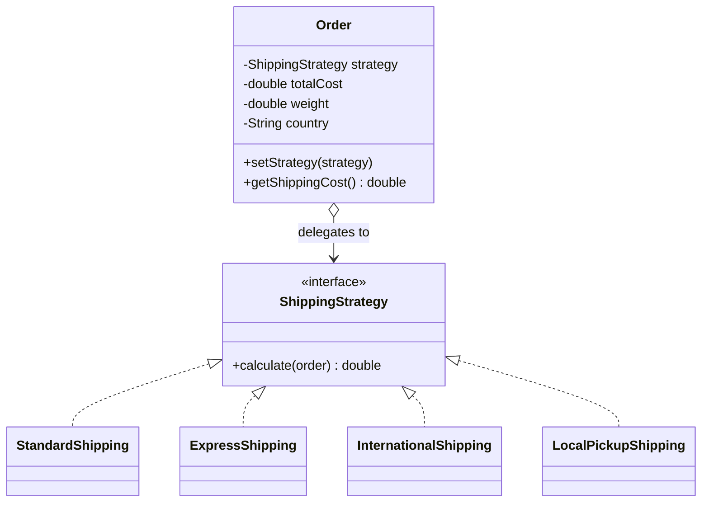

# Strategy Pattern: E-Commerce Shipping Rate Calculator

## Problem

An online store must calculate shipping costs for an order. Each delivery method (Standard, Express, International, Local Pickup) has its own pricing rules, and the customer can change the method at checkout.

> ✍️ **My own take (scroll down if you prefer the clean, AI-structured breakdow) :**
>
> Each order has a field named `strategy` which is typed as the strategy interface (it holds a reference to one of the concrete strategies). All strategies are implementing this interface, so they are sharing the same structure (simply in our case the method `calculate`), but each one implements it in a different way. Based on that reference, when the order is created and we want to calculate the shipping cost, we simply call the order strategy’s `calculate` method.
> As a result, the calculation changes based on the `strategy` field of the order.
>
> **Gain :**
> - To add a strategy, we need only to add another file that implements the same interface `ShippingStrategy`. No existing code needs to be modified (the client just creates it and gives it to the order).
> - Strategies can be switched during runtime, we only need to update the value of the `strategy` field with the new reference.
> - The `Order` class has no `if/else` on the shipping type, it just delegates the calculation to its strategy.
> - Each pricing rule lives in its own class, so changing one rule (for example Express) only touches that file.
>
> **Cons :**
> - Additional files to create. *(When there are many strategies the number of files can grow a lot, but this can be reduced by using one parameterized class when strategies only differ by values, or lambdas for simple cases)*

## Solution

Each pricing rule is encapsulated in its own class behind a common interface, `ShippingStrategy`. The `Order` (the *context*) holds a reference to the interface and delegates the calculation to it.

## Class Diagram



## Roles

| Role | Class | Responsibility |
|---|---|---|
| Strategy | `ShippingStrategy` | Common contract: `calculate(order)` |
| Concrete strategies | `StandardShipping`, `ExpressShipping`, `InternationalShipping`, `LocalPickupShipping` | One pricing rule each |
| Context | `Order` | Holds a strategy and delegates `getShippingCost()` to it |
| Client | `Main` | Chooses the concrete strategy and can swap it at runtime |

## Pricing Rules

| Strategy | Rule |
|---|---|
| Standard | `5.00 + 1.50 × weight`, free if the subtotal is at least 100 |
| Express | `15.00 + 3.00 × weight` |
| International | base (`25` Europe, `40` elsewhere) `+ 6.00 × weight + 5%` of the subtotal. Rejects weights above 30 kg |
| Local Pickup | Free |

## Project Structure

```
strategy/
├── ShippingStrategy.java
├── Order.java
├── StandardShipping.java
├── ExpressShipping.java
├── InternationalShipping.java
├── LocalPickupShipping.java
├── Main.java
└── strategy.md
```

## How to Run

```bash
cd behavioral/strategy
javac -d out *.java
java -cp out Main
```

## Expected Output

```
Order 1 (Standard): 12.5
Order 2 (Local Pickup): 0.0
Order 3 (Express): 75.0
Order 4 (International): 133.75
Order 1 after switching to Express: 30.0
Error: Weight exceeds the limit for international shipping (30.0 kg).
```

