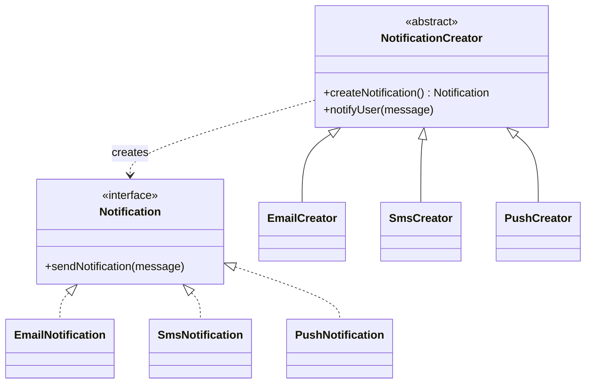

# Factory Method Pattern: Multi-Channel Notification System

## Problem

Build a notification system that sends alerts through different channels (Email, SMS, Push Notification, WhatsApp).

## Challenge

- The business logic must **not** hardcode `new EmailNotification()` or use massive `if/else` checks.
- Adding a new channel (e.g. Slack) must only require **new classes**, without modifying existing code (Open/Closed Principle).

## Solution

Creation is delegated to subclasses. An abstract creator declares a **factory method** (`createNotification()`), and each concrete creator overrides it to return its own product. The abstract creator also holds the business logic (`notifyUser`), which only depends on the `Notification` interface.

## Class Diagram



## Roles

| Role | Class | Responsibility |
|---|---|---|
| Product | `Notification` | Common contract: `sendNotification(message)` |
| Concrete products | `EmailNotification`, `SmsNotification`, `PushNotification` | The objects that do the real work (sending) |
| Creator | `NotificationCreator` (abstract) | Declares `createNotification()` and implements `notifyUser(message)` |
| Concrete creators | `EmailCreator`, `SmsCreator`, `PushCreator` | Each overrides `createNotification()` to return its own product |
| Client | `Main` | Picks a creator and works with it through the abstract type |

**Creators vs. products:** `EmailCreator` sends no email. It only *builds* an `EmailNotification`, and the product contains the sending logic.

An `abstract` class cannot be instantiated: `new NotificationCreator()` is a compile error, so a concrete subclass is always required.

## Why Not a Simple Factory?

A single `NotificationFactory` with `if/else` on a type string works, but adding Slack means **editing that class**, which violates the Open/Closed Principle. With Factory Method, adding Slack means adding `SlackNotification` and `SlackCreator`, and touching nothing else.

## Strategy vs. Factory Method

| | Strategy | Factory Method |
|---|---|---|
| Question | Which *algorithm* to run? | Which *object* to create? |
| Who chooses | The client injects the strategy into the context | Each creator subclass decides which product to instantiate |
| Hierarchies | **One** (the strategies) | **Two parallel**: products *and* creators |
| Key mechanism | **Composition** (`Order` *has a* strategy) | **Inheritance**: the subclass overrides `createNotification()` |
| Timing | Can change at runtime (`setStrategy`) | Fixed when the creator is created |

## Project Structure

```
factory_method/
├── Notification.java
├── EmailNotification.java
├── SmsNotification.java
├── PushNotification.java
├── NotificationCreator.java
├── EmailCreator.java
├── SmsCreator.java
├── PushCreator.java
├── Main.java
└── README.md
```

## How to Run

```bash
cd creational/factory_method
javac -d out design_patterns_practice/creational/factory_method/*.java
java -cp out design_patterns_practice.creational.factory_method.Main
```

## Expected Output

```
Sending email notification with message: Your order has shipped
Sending SMS notification with message: Your verification code is 4821
Sending email notification with message: Weekly summary available
Sending SMS notification with message: Weekly summary available
Sending push notification with message: Weekly summary available
```

## Adding a New Channel

To add Slack, create `SlackNotification implements Notification` and `SlackCreator extends NotificationCreator`. No existing file changes.

## Key Takeaways

- **Creation is delegated** to subclasses, so business logic never calls `new` on a concrete product.
- **Open/Closed Principle**: new channels are added by extension, not modification.
- **Programming to abstractions**: the client declares `NotificationCreator creator`, never `EmailCreator`.

## Done When

- [x] `notifyUser` contains no `new` of a concrete product and no `if/else`.
- [x] Slack can be added without editing any existing file.
- [x] `Main` only uses the abstract creator type.