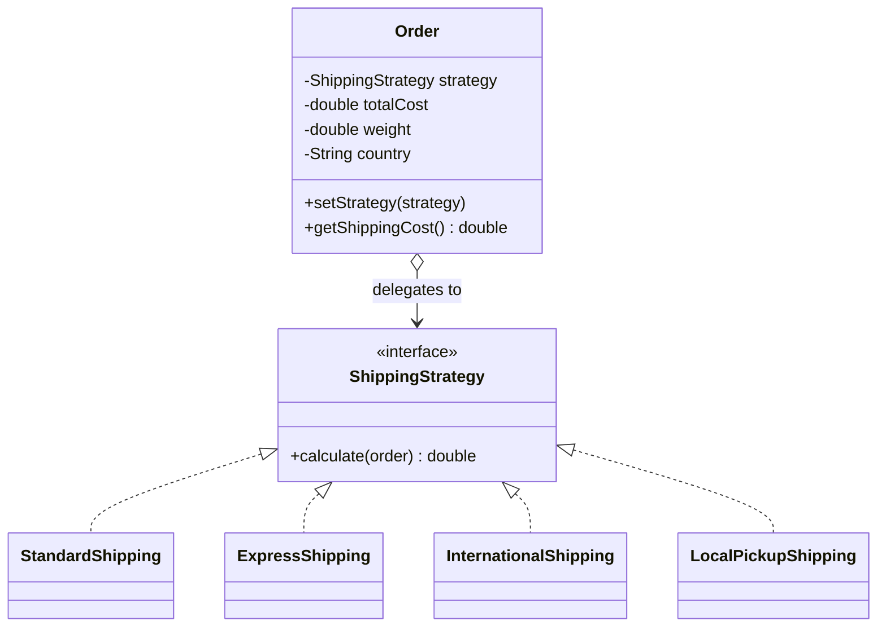

# Strategy Pattern: E-Commerce Shipping Rate Calculator

## Problem

An online store must calculate shipping costs for an order. Each delivery method (Standard, Express, International, Local Pickup) has its own pricing rules, and the customer can change the method at checkout.

## Solution

Each pricing rule is encapsulated in its own class behind a common interface, `ShippingStrategy`. The `Order` (the *context*) holds a reference to the interface and delegates the calculation to it.

## Class Diagram



## Roles

| Role | Class | Responsibility |
|---|---|---|
| Strategy | `ShippingStrategy` | Common contract: `calculate(order)` |
| Concrete strategies | `StandardShipping`, `ExpressShipping`, `InternationalShipping`, `LocalPickupShipping` | One pricing rule each |
| Context | `Order` | Holds a strategy and delegates `getShippingCost()` to it |
| Client | `Main` | Chooses the concrete strategy and can swap it at runtime |

## Pricing Rules

| Strategy | Rule |
|---|---|
| Standard | `5.00 + 1.50 × weight`, free if the subtotal is at least 100 |
| Express | `15.00 + 3.00 × weight` |
| International | base (`25` Europe, `40` elsewhere) `+ 6.00 × weight + 5%` of the subtotal. Rejects weights above 30 kg |
| Local Pickup | Free |

## Project Structure

```
strategy/
├── ShippingStrategy.java
├── Order.java
├── StandardShipping.java
├── ExpressShipping.java
├── InternationalShipping.java
├── LocalPickupShipping.java
├── Main.java
└── strategy.md
```

## How to Run

```bash
cd strategy
javac -d out *.java
java -cp out Main
```

## Expected Output

```
Order 1 (Standard): 12.5
Order 2 (Local Pickup): 0.0
Order 3 (Express): 75.0
Order 4 (International): 133.75
Order 1 after switching to Express: 30.0
Error: Weight exceeds the limit for international shipping (30.0 kg).
```